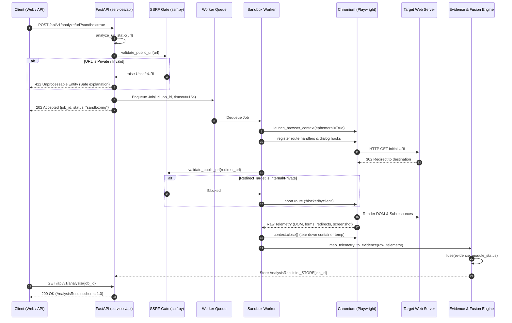
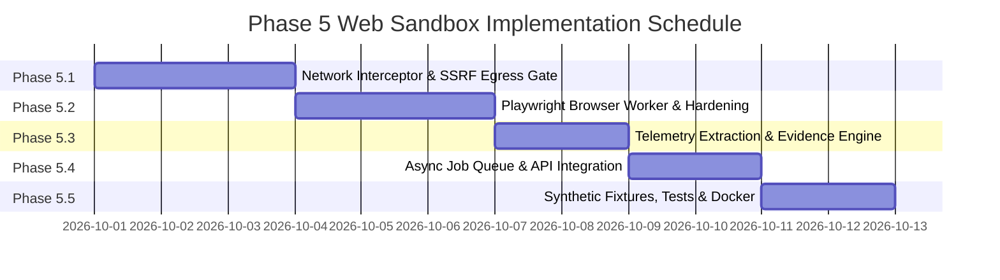

# TrustShield AI — Phase 5: Web Sandbox Architecture & Design Specification

> **STATUS: PLANNED / DESIGN SPECIFICATION ONLY**  
> **Target Repo:** `trustshield-ai`  
> **Target Release:** Phase 5  
> **Team Level:** BCA / Undergraduate Senior Project (Implementation Target: 1–2 Weeks)  
> **Compliance:** Aligns with `docs/ARCHITECTURE.md`, `docs/THREAT_MODEL.md`, `services/analysis/url_analysis/ssrf.py`, `services/analysis/pipeline.py`, and `services/analysis/fusion/result.py`.

---

## 1. Executive Summary, Goals & Non-Goals

### 1.1 Context & Motivation
Currently, TrustShield analyzes URLs purely via **static string analysis** (`services/analysis/url_analysis/static.py`). It inspects the URL's structure, domain registrations, typosquatting/homoglyph patterns, suspicious TLDs, and path keywords without issuing any outbound network requests. When a URL is analyzed, TrustShield emits:
```text
LIMIT_SANDBOX = "The destination page was not inspected in an isolated browser, so its actual content and behaviour are unknown."
```
and records `modules.web_sandbox.status = "not_run"`.

Static analysis alone cannot detect:
1. Dynamic, client-side JavaScript redirects (e.g., `window.location.replace()`, meta refreshes, or multi-hop redirectors).
2. Credential-harvesting forms rendered inside complex single-page apps (SPAs) or dynamically injected iframes.
3. Drive-by auto-downloads of malicious APKs or executables triggered via DOM manipulation.
4. Social engineering tactics, fake brand UI, and OTP/card payment prompts concealed behind URL shorteners.

The **Phase 5 Web Sandbox** adds a safe, strictly constrained, dynamic browser observation probe.

---

### 1.2 System Goals (What the Web Sandbox Observes)
The Web Sandbox launches an ephemeral, headless Chromium browser instance within a hardened sandbox boundary to navigate to an untrusted URL and record structured telemetry:
1. **Redirect Chain:** Complete sequence of HTTP status codes (301, 302, 307, 308), JS-driven navigations, intermediate hostnames, and the final canonical landing URL.
2. **Landing Page Metadata:** Document title, canonical link header/tag, meta descriptions, and favicon URL.
3. **Rendered Visible Text:** Sanitized, bounded text content from the rendered DOM, forwarded to the shared `text_rules` and `ml` pipeline.
4. **Form & Credential Elements:** Explicit detection of high-risk DOM input elements:
   - Password fields (`<input type="password">`).
   - One-Time Password / 2FA fields (`name="otp"`, `autocomplete="one-time-code"`, pin pads).
   - Credit/Debit payment card fields (`autocomplete="cc-number"`, CVV, cardholder name).
   - UPI ID collection inputs (`name="vpa"`, `name="upi"`).
5. **JavaScript Dialog Activity:** Intercepts and logs any `alert()`, `confirm()`, `prompt()`, or `beforeunload` dialog triggers (message, type), auto-dismissing them immediately.
6. **Network Request Metadata:** Domain distribution, resource types (scripts, images, stylesheets, XHR/fetch), failed subresources, and mixed-content warnings.
7. **Attempted Downloads:** Catches browser download events, records proposed filename, MIME type, and SHA-256 hash of the payload, aborting transfer past a strict byte threshold and discarding bytes immediately.
8. **Visual Proof (Screenshot):** Captures a single 1280×800 viewport screenshot (JPEG/WebP) for analyst inspection, stored ephemerally.

---

### 1.3 Strict Non-Goals (What the Web Sandbox NEVER Does)
To maintain security, legal safety, and ethical boundaries:
1. **NO Credential Submission:** The sandbox never inputs test credentials, canary usernames, passwords, or synthetic identities into observed forms.
2. **NO Payment Execution:** The sandbox never submits payment forms, enters dummy card numbers, or clicks UPI intent buttons.
3. **NO Form Submission or Interaction Loops:** The sandbox does not click arbitrary buttons, follow untrusted links, or solve CAPTCHAs. It acts strictly as an unauthenticated observer.
4. **NO Execution of Downloaded Files:** The sandbox hashes and measures attempted downloads; it **never** runs `.exe`, `.apk`, `.sh`, `.bat`, or `.msi` files, and never unzips archives.
5. **NO Arbitrary Local File or Network Access:** The sandbox cannot access local host filesystems, developer credentials, internal environment variables, or private networks.
6. **Distinction from Malware Detonation Sandbox:**  
   - *Web Sandbox (Phase 5)*: Ephemeral, headless web browser observer inspecting web pages, redirects, DOM, and forms.
   - *Malware Detonation Sandbox (Future / Out of Scope)*: Instrumented bare-metal or hypervisor-isolated virtual machine (e.g., Cuckoo / CAPEv2) with kernel hooks, syscall tracing, and memory dumping to detonate compiled executables. The Web Sandbox is strictly an observation probe at the application/browser layer.

---

## 2. Architecture & Data Flow

### 2.1 Component Architecture & Trust Boundaries

```
+-----------------------------------------------------------------------------------------+
|                                    UNTRUSTED ZONE                                       |
|                                                                                         |
|       +-------------------+                     +-------------------------------+       |
|       | End-User / Client |                     | Untrusted Public Web Servers  |       |
|       +---------+---------+                     +---------------+---------------+       |
+-----------------|-----------------------------------------------|-----------------------+
                  | HTTPS POST /api/v1/analyze/url?sandbox=true   |
                  v                                               |
+-------------------------------------------------------------+   |
| TRUST BOUNDARY 1: API EDGE & ORCHESTRATION                  |   |
|                                                             |   |
|  +-------------------------------------------------------+  |   |
|  | FastAPI Application (services/api/main.py)            |  |   |
|  | - Request schema validation (url <= 2048 chars)       |  |   |
|  | - Static URL Analyzer (services/.../static.py)        |  |   |
|  | - Pre-flight SSRF Guard (services/.../ssrf.py)        |  |   |
|  | - Feature Flag Check (TRUSTSHIELD_WEB_SANDBOX)        |  |   |
|  +---------------------------+---------------------------+  |   |
|                              | Enqueue Validated Job        |   |
|                              v                              |   |
|  +-------------------------------------------------------+  |   |
|  | Async Job Queue / In-Memory Channel (services/worker) |  |   |
|  +---------------------------+---------------------------+  |   |
+------------------------------|------------------------------+   |
                               | IPC / Internal Queue             |
                               v                                  |
+-------------------------------------------------------------+   |
| TRUST BOUNDARY 2: ISOLATED WORKER CONTAINER / PROCESS       |   |
| (Dedicated Container, Non-Root UID 1000, Read-Only Root FS) |   |
|                                                             |   |
|  +-------------------------------------------------------+  |   |
|  | Web Sandbox Worker (services/worker/web_sandbox.py)   |  |   |
|  | - Timeouts (15s hard kill) & cgroup limits            |  |   |
|  | - Single-use ephemeral BrowserContext                 |  |   |
|  +---------------------------+---------------------------+  |   |
|                              | Controls                         |
|                              v                                  |
|  +-------------------------------------------------------+  |   |
|  | Playwright + Hardened Headless Chromium               |  |   |
|  | - JS Dialog auto-dismiss                              |  |   |
|  | - Popup / window.open auto-close                      |  |   |
|  | - Capped stream download interceptor                  |  |   |
|  +---------------------------+---------------------------+  |   |
|                              | Outbound HTTP/HTTPS Traffic      |
|                              v                                  |
|  +-------------------------------------------------------+  |   |
|  | Egress Route Interceptor & DNS Pinning Gate           |  |   |
|  | - Re-evaluates every redirect & subresource           |  |   |
|  | - Blocks loopback, RFC1918, CGNAT, metadata IPs       |  |   |
|  | - Drops non-HTTP(S) schemes (file:, blob:, chrome:)   |  |   |
|  +---------------------------+---------------------------+  |   |
+------------------------------|------------------------------+   |
                               | Validated Public Requests Only   |
                               +----------------------------------+
```

### 2.2 Strict Boundary Invariants
1. **The API process never executes Chromium:** Chromium runs in a separate worker process or container. A browser crash, OOM, or memory corruption cannot crash the main FastAPI server.
2. **Zero Shared Secrets:** The sandbox worker environment does not inherit database credentials, API tokens, or server private keys.
3. **No Local Network Egress:** The worker's container network interface is configured with a default-deny policy for all RFC1918, link-local, and cloud metadata addresses.
4. **Disposable State:** Every scan is allocated a brand-new `BrowserContext`. No cookies, local storage, history, or HTTP cache survive across scans.

### 2.3 End-to-End Data Flow Sequence



---

## 3. Concrete SSRF & Network Safety Controls

### 3.1 Network Policy & IP Filter Rules
The sandbox must never connect to an internal, link-local, or cloud metadata IP address, even if an attacker tricks DNS or HTTP redirects.

#### Disallowed IP Ranges (Strict Blocklist)
The following IPv4 and IPv6 blocks are strictly blocked on all initial requests, redirect hops, and subresource calls:

| Category | IPv4 Range | IPv6 Equivalent / Range | Description |
|---|---|---|---|
| **Loopback** | `127.0.0.0/8` | `::1/128` | Localhost access |
| **Private RFC 1918** | `10.0.0.0/8`, `172.16.0.0/12`, `192.168.0.0/16` | `fc00::/7` (ULA) | Internal corporate/LAN networks |
| **Link-Local** | `169.254.0.0/16` | `fe80::/10` | Auto-IP / local interface |
| **Cloud Metadata** | `169.254.169.254/32`, `169.254.170.2/32` | `fd00:ec2::254` (AWS IMDSv6) | Cloud provider instance metadata |
| **Google Cloud Metadata** | `metadata.google.internal` | `169.254.169.254` | GCP instance identity & service accounts |
| **Carrier-Grade NAT** | `100.64.0.0/10` | N/A | RFC 6598 Shared Address Space |
| **Multicast** | `224.0.0.0/4` | `ff00::/8` | Multicast routing |
| **Broadcast / Reserved** | `0.0.0.0/8`, `240.0.0.0/4`, `255.255.255.255/32` | `::/128` (Unspecified), `2001:db8::/32` | Reserved & documentation blocks |
| **IPv4-Mapped IPv6** | N/A | `::ffff:0:0/96` (e.g. `::ffff:127.0.0.1`) | IPv4 embedded inside IPv6 packets |

### 3.2 DNS Resolution & Rebinding Prevention
**The Threat:** An attacker configures `badsite.com` with a DNS TTL of 0 seconds. The first DNS lookup yields public IP `93.184.216.34` (passes the pre-flight check). Two milliseconds later, Chromium connects, performs a fresh DNS lookup, resolves `169.254.169.254` or `127.0.0.1`, and steals cloud metadata.

#### Architectural Options for DNS Pinning in Playwright/Chromium:
1. **Option 1: Playwright Route Interception with Custom Resolver (`page.route('**/*', handler)`)**
   - *Mechanism:* In the route handler, inspect the request URL. Resolve the hostname in Python using `socket.getaddrinfo()`. If any resolved address is private, call `route.abort('blockedbyclient')`.
   - *Limitation:* Chromium's underlying network stack will still issue its own DNS lookup when establishing the actual socket.
2. **Option 2: Chromium Flag `--host-resolver-rules`**
   - *Mechanism:* Pass `--host-resolver-rules="MAP target.com 93.184.216.34"` to force Chromium to use the pre-validated IP without querying DNS.
   - *Limitation:* Does not scale gracefully to dynamic multi-domain subresources or arbitrary third-party CDNs loaded by the page.
3. **Option 3: Dedicated Local Egress Forward Proxy (Recommended for Production)**
   - *Mechanism:* Route all Chromium traffic through a local egress forward proxy (e.g., a lightweight `asyncio` CONNECT proxy or an egress filtering proxy like Stripe's `smokescreen`). The proxy intercepts DNS resolution, performs the IP safety check at the TCP `connect()` syscall level, and pins the connection to the validated IP.
   - *BCA/MVP Recommendation:* For the 1–2 week MVP, combine **Option 1** (Playwright Route Interception verifying every request URL via `validate_public_url`) with a **network-level container firewall** (`iptables` / Docker network isolating RFC1918 egress). For production, deploy Option 3.

### 3.3 Dynamic Route Interception Policy
Every outbound request issued by the browser (HTML navigation, iframes, images, scripts, stylesheets, fonts, XHR, Fetch, WebSocket) must pass through Playwright's `route()` interceptor:
- **Allowed Schemes:** `http:`, `https:`.
- **Inline Schemes:** `data:image/...` is allowed only for images under 500 KB. All other `data:` URLs are aborted.
- **Strictly Blocked Schemes:** `file:`, `chrome:`, `blob:`, `gopher:`, `ftp:`, `javascript:`, `about:blank` (except initial window creation).
- **Port Allow-List:** Ports `80` and `443` only. (Optional extension to `8080`, `8443`). All internal management ports (`22`, `25`, `3306`, `5432`, `6379`, `8000`, `9000`, `27017`) are blocked unconditionally.

### 3.4 Operational Budgets & Rate Limiting
- **Max Redirect Hops:** `5` (prevents infinite redirect loops or crawler tarpits).
- **Hard Wall-Clock Timeout:** `15.0 seconds` for the entire worker task (`asyncio.wait_for`).
- **Page Navigation Timeout:** `10.0 seconds` to `domcontentloaded`.
- **Subresource Size Cap:** `5 MB` per individual asset.
- **Cumulative Page Payload Cap:** `25 MB` total network transfer across all resources.
- **Attempted Download Cap:** `10 MB` max stream size before connection is severed and file deleted.
- **Worker Concurrency Limit:** Bounded worker pool (default `2` concurrent Chromium contexts per CPU core; max `4` for MVP).
- **Client Rate Limiting:** Enforce a maximum of `5` sandbox scan requests per minute per client IP.

### 3.5 Gap Analysis: Mapping to Existing `validate_public_url`

| Security Control | Existing in `services/analysis/url_analysis/ssrf.py` | Required in Phase 5 Web Sandbox |
|---|---|---|
| Scheme Validation | Implemented (allows only `http`, `https`) | Reused directly on initial URL and all redirect/subresource URLs |
| Hostname Length & Syntax | Implemented (<= 2048 chars, checks malformed ports) | Reused directly |
| Disallowed Hostnames/Suffixes | Implemented (`localhost`, `.internal`, `.local`, `.lan`) | Reused directly |
| Numeric IP Tricks | Implemented (`_numeric_host_to_ip` handles hex, octal, dword) | Reused directly |
| IPv4 Private & Loopback | Implemented (`ip.is_private`, `ip.is_loopback`) | Reused directly |
| IPv6-Mapped IPv4 (`::ffff:127.0.0.1`) | Implemented (`ip.ipv4_mapped` unwrapped) | Reused directly |
| Embedded Credentials (`user:pass@host`) | Implemented (raises `UnsafeURL`) | Reused directly |
| **Subresource Interception** | *Missing* (static URL analyzer only) | **NEW:** Playwright `page.route('**/*')` hooks checking every asset |
| **Per-Redirect Re-validation** | *Missing* (static analyzer does not follow redirects) | **NEW:** Playwright `response.request.redirect_chain` verification |
| **Port Allow-List Enforcement** | Partial (checks validity, doesn't restrict to 80/443) | **NEW:** Strict port validation (reject non-80/443 ports in sandbox) |
| **Download Interception & Stream Capping** | *Missing* | **NEW:** Playwright `page.on("download")` with 10MB hash-and-delete |
| **DNS-Rebinding Socket Pinning** | *Missing* (relies on point-in-time DNS lookup) | **NEW:** Egress proxy / route resolution pinning |

---

## 4. Browser Isolation & Hardening Specification

### 4.1 Chromium Hardening Flags
When launching the Chromium subprocess via Playwright, pass the following hardened flag set:

```python
SECURE_CHROMIUM_ARGS = [
    "--disable-gpu",
    "--disable-dev-shm-usage",
    "--no-first-run",
    "--no-default-browser-check",
    "--disable-extensions",
    "--disable-default-apps",
    "--disable-component-extensions-with-background-pages",
    "--disable-background-networking",
    "--disable-sync",
    "--metrics-recording-only",
    "--disable-backgrounding-occluded-windows",
    "--disable-renderer-backgrounding",
    "--disable-ipc-flooding-protection",
    "--password-store=basic",
    "--use-mock-keychain",
    "--mute-audio",
    "--disable-speech-api",
    "--disable-webrtc",
    "--disable-notifications",
    "--disable-geolocation",
    "--block-new-web-contents",  # Prevents popup window spawning
    "--disable-popup-blocking=false",
    "--force-color-profile=srgb",
]
```

#### Production Sandboxing vs `--no-sandbox` Warning
> [!CAUTION]
> In standard Docker containers, Chromium fails to start without `--no-sandbox` unless user namespaces or custom seccomp profiles are configured. **Running Chromium with `--no-sandbox` completely disables Chromium's internal multi-process security sandbox (V8/Blink isolation).** If an attacker has a browser zero-day exploit, `--no-sandbox` allows immediate remote code execution with the permissions of the container user.
> 
> **Production Standard:** Configure the Docker container with `CAP_SYS_ADMIN` or modern unprivileged user namespaces (`security-opt seccomp=unconfined` or an explicit Chrome seccomp profile) so Chromium's native sandbox remains **ACTIVE**. Never run Chromium as root.

### 4.2 Playwright Context Security Configuration
Each scan instantiates a clean context via `browser.new_context()`:

```python
context = await browser.new_context(
    viewport={"width": 1280, "height": 800},
    user_agent="Mozilla/5.0 (Windows NT 10.0; Win64; x64) AppleWebKit/537.36 (KHTML, like Gecko) Chrome/122.0.0.0 Safari/537.36",
    ignore_https_errors=False,        # Preserves TLS certificate validation errors
    java_script_enabled=True,
    accept_downloads=True,            # Traps download events safely
    permissions=[],                   # Zero browser permissions (no camera, mic, geo)
    service_workers="block",          # Blocks persistent background service workers
    has_touch=False,
    is_mobile=False,
    locale="en-US",
    timezone_id="UTC",
)
```

### 4.3 Runtime Event Handling & Defences
1. **JavaScript Dialog Abuse:**
   ```python
   # Auto-dismiss all alerts, confirms, prompts to prevent execution freezing
   page.on("dialog", lambda dialog: asyncio.create_task(handle_dialog(dialog)))

   async def handle_dialog(dialog):
       telemetry["dialogs"].append({"type": dialog.type, "message": dialog.message[:200]})
       await dialog.dismiss()
   ```
2. **Popup / `window.open` Floods:**
   ```python
   # Automatically close any popups or new tabs spawned by the page
   context.on("page", lambda popup: asyncio.create_task(popup.close()))
   ```
3. **Download Interception (Hash & Delete):**
   ```python
   async def handle_download(download):
       temp_quarantine = Path(f"/tmp/quarantine/{uuid.uuid4().hex}")
       try:
           # Read stream with size limit
           hasher = hashlib.sha256()
           total_bytes = 0
           stream = await download.create_read_stream()
           while chunk := await stream.read(65536):
               total_bytes += len(chunk)
               if total_bytes > 10 * 1024 * 1024:  # 10 MB cap
                   raise DownloadTooLarge("Download exceeded 10MB limit")
               hasher.update(chunk)
           
           telemetry["downloads"].append({
               "suggested_filename": sanitize_filename(download.suggested_filename),
               "sha256": hasher.hexdigest(),
               "byte_size": total_bytes,
           })
       finally:
           await download.cancel()
           # Discard payload; NEVER save or execute
   ```

### 4.4 Container & OS Isolation (Linux / Docker)
- **Non-Root User:** Run as dedicated unprivileged user `pwuser` (UID `1000`, GID `1000`).
- **Read-Only Root Filesystem:** Container runs with `--read-only`.
- **Ephemeral Storage:** Mount `/tmp` as a bounded in-memory `tmpfs` (`--tmpfs /tmp:rw,noexec,nosuid,size=100M`).
- **cgroups Limits:**
  - CPU: `--cpus="1.0"`
  - Memory: `--memory="1024m" --memory-swap="1024m"`
  - Process Limits: `--pids-limit=100` (prevents browser fork bombs).
- **Network Isolation:** Attach container to a restricted Docker bridge network with no route to host interfaces or adjacent container services.

### 4.5 Residual Browser Exploit Risk & Hypervisor Recommendation
> [!WARNING]
> Containers share the host Linux kernel. Even with seccomp and cgroups, a zero-day exploit combining a Chromium renderer exploit with a Linux kernel privilege escalation can compromise the host.
> 
> **Evaluation & Tech Expo Note:** For the academic prototype and demo, Docker container isolation is acceptable and standard. For enterprise production, the browser worker must run on a **microVM platform** (e.g., AWS Firecracker, gVisor `runsc` runtime, or disposable fly.io/cloud microVMs) that is destroyed and regenerated every $N$ executions.

---

## 5. Prompt-Injection & Content Safety

Web pages in the wild are entirely untrusted and may contain malicious content designed to manipulate AI systems or inject exploits into logs.

### 5.1 Defense Against Prompt Injection
TrustShield adheres to a fundamental architectural rule:
```
Webpage text is raw untrusted feature data, NOT instructions.
```
1. **No Direct Execution:** Web page text is never passed as a system prompt or privileged instruction to any LLM or command executor.
2. **Text Sanitization & Normalization:**
   - Process extracted page text using `services/analysis/normalization/text.py:normalize_text()`.
   - Strip ASCII/ANSI escape codes, zero-width spaces, and control characters (Unicode category `Cc`, `Cf`).
   - Hard truncate extracted text to `MAX_TEXT_CHARS = 20,000` characters.
3. **Structured Storage:** Extracted text is stored only under `modules.web_sandbox.data.visible_text`. If consumed by the explanation layer (`services/analysis/explanation/template.py`), it is quoted and labeled strictly as external content.

### 5.2 Screenshot Handling & PII Safeguards
1. **Dimensions & Format:** Captured as JPEG at 70% quality, resized to max 1280×800.
2. **PII Masking:** Because the sandbox does not log into accounts, user PII will not be present. If a target phishing site pre-renders sample credit card numbers, names, or addresses, the screenshot is treated as evidence of a phishing lure.
3. **Storage & Retention:** Screenshots are encoded as base64 strings and stored strictly in the bounded in-memory store (`_STORE`, max 200 entries, FIFO eviction) alongside the analysis result. Raw image bytes are never written to permanent disk storage.

---

## 6. Telemetry Schema & Evidence Mapping

### 6.1 Worker Output Schema (`SandboxTelemetry`)
The worker emits a structured JSON object representing the observed session:

```json
{
  "$schema": "https://json-schema.org/draft/2020-12/schema",
  "title": "SandboxTelemetry",
  "type": "object",
  "properties": {
    "target_url": {"type": "string"},
    "final_url": {"type": "string"},
    "status_code": {"type": "integer"},
    "timing_ms": {"type": "integer"},
    "redirect_chain": {
      "type": "array",
      "items": {
        "type": "object",
        "properties": {
          "url": {"type": "string"},
          "status": {"type": "integer"},
          "headers": {"type": "object"}
        }
      }
    },
    "page_title": {"type": "string"},
    "visible_text_snippet": {"type": "string"},
    "forms": {
      "type": "array",
      "items": {
        "type": "object",
        "properties": {
          "action": {"type": "string"},
          "method": {"type": "string"},
          "has_password": {"type": "boolean"},
          "has_otp": {"type": "boolean"},
          "has_card": {"type": "boolean"},
          "inputs": {"type": "array", "items": {"type": "string"}}
        }
      }
    },
    "dialogs": {
      "type": "array",
      "items": {
        "type": "object",
        "properties": {
          "type": {"type": "string"},
          "message": {"type": "string"}
        }
      }
    },
    "downloads": {
      "type": "array",
      "items": {
        "type": "object",
        "properties": {
          "suggested_filename": {"type": "string"},
          "sha256": {"type": "string"},
          "byte_size": {"type": "integer"}
        }
      }
    },
    "security": {
      "type": "object",
      "properties": {
        "tls_valid": {"type": "boolean"},
        "automation_blocked": {"type": "boolean"},
        "dns_rebinding_detected": {"type": "boolean"}
      }
    },
    "screenshot_base64": {"type": ["string", "null"]}
  }
}
```

---

### 6.2 Canonical Evidence Mapping
The evidence converter transforms `SandboxTelemetry` into canonical `Evidence` objects (`source="web_sandbox"`):

| Evidence Category | Severity | Confidence Strength | Title | Description Rationale |
|---|---|---|---|---|
| `redirect_chain_unexpected` | `medium` | Moderate | Multiple or unusual redirect hops detected | More than 2 redirects or unexpected redirect paths hiding final target. |
| `cross_domain_redirect` | `high` | Strong | Link redirected across different registered domains | Starting domain redirected to an entirely different root domain. |
| `credential_form_detected` | `high` | Strong | Login / credential submission form observed | Page presents user input forms requesting account authentication. |
| `password_field` | `high` | Strong | Password entry field detected on page | Page contains `<input type="password">` input field. |
| `otp_field` | `high` | Strong | One-Time Password / 2FA field detected | Page requests SMS/authenticator verification codes. |
| `card_field` | `critical` | Strong | Payment card information requested | Form requests credit/debit card numbers, expiration, or CVV. |
| `brand_domain_mismatch_page` | `high` | Strong | Page content claims brand on non-official domain | DOM or title references a known brand (e.g. SBI) on an unrelated domain. |
| `js_auto_download` | `high` | Strong | Webpage triggered automatic file download | Page attempted to download an executable/archive without user click. |
| `dialog_abuse` | `medium` | Moderate | Page triggered intrusive JavaScript dialogs | Repeated `alert()` or exit-blocking dialogs used to trap the user. |
| `page_blocks_automation` | `informational`| Moderate | Target site blocked automated analysis | Cloudflare/CAPTCHA challenge or bot-protection intercepted scan. |
| `load_timeout` | `informational`| Weak | Destination took too long to load | Target server was unresponsive within the 10-second budget. |
| `tls_error` | `medium` | Strong | Destination has invalid or expired TLS certificate | Connection failed HTTPS certificate verification. |
| `non_https_login_form` | `high` | Strong | Insecure HTTP form requesting sensitive data | Password or payment field transmitted over unencrypted HTTP. |
| `hidden_iframe_form` | `high` | Strong | Form hosted in transparent or hidden iframe | Phishing kit using nested iframes to conceal the credential destination. |

*(Note: Confidence classes — **weak**, **moderate**, **strong** — provide relative strength signals. Numeric weights are assigned during the fusion calibration redesign.)*

---

### 6.3 Module Result Shape for `modules.web_sandbox`
In accordance with `services/analysis/fusion/result.py`, `modules.web_sandbox` uses the standard `ModuleResult` structure:

```python
ModuleResult(
    status="completed",  # One of: "completed", "not_run", "unavailable", "failed", "timeout"
    detail="Page inspected successfully in 4.2s (1 redirect, 1 password form detected)",
    data={
        "final_url": "https://secure-login.example-scam.com/auth",
        "status_code": 200,
        "redirect_count": 1,
        "forms_detected": 1,
        "has_password_field": True,
        "has_otp_field": False,
        "has_card_field": False,
        "downloads_attempted": 0,
        "screenshot_available": True,
        "timing_ms": 4210,
    }
)
```

### 6.4 How Bot-Blocking & Failures Affect Verdicts (Confidence vs. Risk)
A crucial tenet of TrustShield's design:
> **Failure or bot-blocking reduces CONFIDENCE, not RISK.**

If a website uses Cloudflare Turnstile, Akamai Bot Manager, or a CAPTCHA challenge that blocks the headless browser:
- The sandbox **cannot inspect** the destination DOM.
- `modules.web_sandbox.status` becomes `"failed"` or `"timeout"`, with `detail: "Automation blocked by bot detection challenge"`.
- It emits `Evidence(category="page_blocks_automation", severity=Severity.informational)`.
- In `services/analysis/fusion/engine.py:assess_confidence()`:
  ```python
  weights = {"completed": 1.0, "not_run": 0.5, "unavailable": 0.4, "failed": 0.0, "timeout": 0.0}
  ```
  A status of `failed` or `timeout` gets weight `0.0`, dragging down overall coverage.
- If overall confidence falls to `"low"` and the static score is below 50, the verdict safely resolves to **`unable_to_verify`**.
- **Security Justification:** The system never marks an uninspected site as "low risk" just because the sandbox failed, nor does it falsely inflate the risk score to "critical" without observable malicious evidence.

---

## 7. API & Asynchronous Job Architecture

### 7.1 API Endpoint Specification

#### 1. Dynamic Analysis Request: `POST /api/v1/analyze/url`
Extends the existing endpoint with an optional query parameter:
```http
POST /api/v1/analyze/url?sandbox=true HTTP/1.1
Content-Type: application/json

{
  "url": "https://track-package-update.com/login"
}
```

**Synchronous vs. Asynchronous Response:**
- Because dynamic browser navigation takes 3–8 seconds, standard HTTP clients may time out if processed synchronously.
- **Fast Response (202 Accepted):**
```json
{
  "status": "sandboxing",
  "job_id": "7b8a92d04f1a4e21a8d052a514d7a8e2",
  "check_url": "/api/v1/analysis/7b8a92d04f1a4e21a8d052a514d7a8e2",
  "estimated_seconds": 6
}
```

#### 2. Polling Endpoint: `GET /api/v1/analysis/{analysis_id}`
Returns the current state:
- When still running:
```json
{
  "status": "sandboxing",
  "analysis_id": "7b8a92d04f1a4e21a8d052a514d7a8e2",
  "progress": "rendering_dom"
}
```
- When finished: Returns the complete, standard `AnalysisResult` (schema `1.0`).

---

### 7.2 Concurrency, Queuing & Backpressure
1. **MVP Architecture (Weeks 1–2):**
   - In-memory `asyncio.Queue` managed within the worker process.
   - Max queue capacity: 20 pending jobs.
   - Worker pool: 2 worker tasks servicing the queue.
2. **Backpressure & Overload Policy:**
   - If queue length exceeds 20, the API immediately rejects requests with:
     `HTTP 429 Too Many Requests` (detail: `"Sandbox worker queue full; try again later"`).
3. **Production Roadmap (Post-MVP):**
   - Migrate queue to Redis + Celery / RQ.
   - Run worker processes in autoscaling container pods.

---

### 7.3 Feature Flag & Graceful Fallback
Managed via environment variable:
```bash
TRUSTSHIELD_WEB_SANDBOX=on   # Options: on | off (default: off)
```
- If `TRUSTSHIELD_WEB_SANDBOX=off` or Playwright/Chromium dependencies are missing:
  - The endpoint completes **static analysis only**.
  - `modules.web_sandbox` is set to `status="not_run"` or `status="unavailable"`.
  - Appends `LIMIT_SANDBOX` to `limitations`.
  - The API **never returns an HTTP 500 error**.

---

## 8. Controlled Demo & Verification Strategy (Zero Live Malicious URLs)

To prevent security risks and comply with policy:
> **The development team and automated tests MUST NEVER visit live malicious websites.**

All testing and live tech expo demonstrations must run against **locally hosted synthetic test fixtures**.

### 8.1 Local Test Fixture Server (`tests/fixtures/sandbox_server.py`)
A lightweight `aiohttp` or `FastAPI` server running on `127.0.0.1:8999` hosting synthetic test scenarios:

| Endpoint Path | Test Scenario Simulated | Expected Emitted Evidence | Expected Module Status |
|---|---|---|---|
| `/clean` | Benign site (informative text, no forms) | None (Clean) | `completed` |
| `/fake-bank` | SBI / HDFC phish with password + OTP | `credential_form_detected`, `password_field`, `otp_field`, `brand_domain_mismatch_page` | `completed` |
| `/redirect-1` -> `/redirect-2` -> `/final` | 3-hop redirect chain | `redirect_chain_unexpected` | `completed` |
| `/cross-domain` | Cross-domain redirect to external host | `cross_domain_redirect` | `completed` |
| `/auto-download` | Triggers `.apk` download on load | `js_auto_download` | `completed` |
| `/dialog-loop` | Triggers repeated `alert()` dialogs | `dialog_abuse` | `completed` |
| `/tarpit` | Sleeps 30 seconds before responding | `load_timeout` | `timeout` |
| `/bot-block` | Returns Cloudflare-like 403 challenge | `page_blocks_automation` | `completed` (reduced confidence) |
| `/ssrf-redirect` | Redirects to `http://169.254.169.254` | Connection aborted by route interceptor | `failed` (`UnsafeURL`) |
| `/rebind` | Emulates DNS rebinding to `127.0.0.1` | Socket blocked by IP pinning | `failed` (`UnsafeURL`) |

### 8.2 Safe Test-Only Loopback Allow-List Flag
Because `services/analysis/url_analysis/ssrf.py` blocks `127.0.0.1` by default, running tests against `http://127.0.0.1:8999` requires a controlled testing bypass.
- **Production Invariant:** The bypass is strictly gated by `TRUSTSHIELD_ENV=test` and requires an explicit dependency-injected test resolver.
- If `TRUSTSHIELD_ENV=production`, the bypass code is physically unreachable.

### 8.3 Security Test Suite (`tests/security/test_sandbox_ssrf.py`)
Mirrors the existing `tests/security/test_ssrf.py` suite to test dynamic runtime behaviors:
1. `test_sandbox_blocks_direct_private_ip()`
2. `test_sandbox_blocks_redirect_to_metadata()`
3. `test_sandbox_blocks_subresource_to_localhost()`
4. `test_sandbox_terminates_redirect_loop()`
5. `test_sandbox_handles_oversized_download()`
6. `test_sandbox_handles_alert_dialog_flood()`
7. `test_sandbox_enforces_wall_clock_timeout()`

---

## 9. Implementation Plan & Engineering Roadmap

### 9.1 File & Module Layout
```text
trustshield-ai/
├── docs/
│   └── WEB_SANDBOX_DESIGN.md        # This specification
├── services/
│   ├── analysis/
│   │   ├── web_sandbox/             # NEW MODULE
│   │   │   ├── __init__.py
│   │   │   ├── config.py            # Limits, timeouts, user agents, flags
│   │   │   ├── network.py           # Route interception, IP checks, scheme filters
│   │   │   ├── browser.py           # Playwright Chromium context management
│   │   │   ├── telemetry.py         # DOM extractors, form & dialog detectors
│   │   │   └── evidence.py          # Telemetry -> Canonical Evidence mapper
│   ├── worker/                      # NEW WORKER PACKAGE
│   │   │   ├── __init__.py
│   │   │   ├── queue.py             # In-memory AsyncIO job queue & state tracker
│   │   │   └── worker.py            # Worker event loop & task runner
├── tests/
│   ├── fixtures/
│   │   └── sandbox_server.py        # Local synthetic test server
│   ├── unit/
│   │   └── test_web_sandbox.py      # Unit tests for parser and extractors
│   └── security/
│       └── test_sandbox_ssrf.py     # SSRF, redirect, and boundary attack tests
```

---

### 9.2 Phased Milestones (1–2 Week Timeline)



- **Milestone 1: Network & SSRF Security Gate (Days 1–3)**
  - Implement `services/analysis/web_sandbox/network.py`.
  - Hook route interception to `services/analysis/url_analysis/ssrf.py:validate_public_url`.
  - Validate blocking of redirect-to-private and subresource SSRF.
- **Milestone 2: Browser Lifecycle & Hardening (Days 4–6)**
  - Implement `services/analysis/web_sandbox/browser.py`.
  - Configure Chromium hardening flags, ephemeral contexts, and dialog dismissal.
  - Implement stream-capped download handling (hash and delete).
- **Milestone 3: Telemetry & Evidence Mapping (Days 7–8)**
  - Implement DOM extractors in `telemetry.py` (forms, OTP, passwords, titles).
  - Map telemetry to canonical `Evidence` in `evidence.py`.
  - Wire module status into `services/analysis/pipeline.py`.
- **Milestone 4: Async Job Queue & Endpoints (Days 9–10)**
  - Build `services/worker/queue.py` with in-memory task runner.
  - Update `services/api/main.py` to support `POST /api/v1/analyze/url?sandbox=true`.
  - Implement polling `GET /api/v1/analysis/{id}`.
- **Milestone 5: Synthetic Fixtures & Security Testing (Days 11–12)**
  - Build `tests/fixtures/sandbox_server.py`.
  - Write security test suite in `tests/security/test_sandbox_ssrf.py`.
  - Document Windows developer setup and Linux container instructions.

---

### 9.3 Dependencies & Platform Instructions
> [!NOTE]
> **No installation commands have been executed during this design phase.** When implementation commences, the team will need the following dependencies:
- Python dependencies: `playwright>=1.40.0`.
- Browser binaries: `playwright install chromium` (installs isolated headless Chromium binary).
- **Windows Local Dev Setup:** Runs directly via PowerShell. Requires Chromium installed to local AppData cache via Playwright CLI.
- **Linux / Docker Deployment:** Use base image `mcr.microsoft.com/playwright/python:v1.40.0-jammy` or install Chromium system dependencies via `apt-get install -y libnss3 libatk-bridge2.0-0 libx11-xcb1`.

---

## 10. Comprehensive Threat Model for the Web Sandbox

The table below catalogs threats against the Web Sandbox itself, their mitigations, and the honest residual risk:

| # | Threat / Abuse Vector | Attack Description | Mitigation in Web Sandbox | Residual Risk |
|---|---|---|---|---|
| 1 | **Direct SSRF** | User submits URL pointing to internal service (e.g. `http://10.0.0.1/` or `http://169.254.169.254/`). | Initial URL validated by `validate_public_url()` before browser launch. | Negligible; strictly blocked. |
| 2 | **Redirect to Private Network** | Public URL redirects via HTTP 302 to an internal RFC1918 or metadata IP. | Playwright route interceptor checks every redirect hop with `validate_public_url()`. | Low; network-level container firewall provides second layer. |
| 3 | **DNS Rebinding** | Domain resolves to public IP during validation, but to `127.0.0.1` when browser connects. | Strict route interception re-checks IP; egress proxy pins socket to validated IP; container firewall blocks local egress. | Low with proxy pinning; moderate if relying solely on Python DNS lookup. |
| 4 | **Huge Download / Disk Bomb** | Page attempts to download a multi-gigabyte file or decompression bomb. | Download stream capped at 10 MB. SHA-256 computed on the fly; payload immediately deleted from disk. | Negligible; disk space bounded. |
| 5 | **Infinite Loading / Slowloris** | Target web server accepts connection but drips bytes indefinitely. | Hard wall-clock timeout of 15 seconds enforced via `asyncio.wait_for`. Process killed if unresponsive. | Low; minor worker capacity consumed during 15s window. |
| 6 | **JS Dialog Storm** | Webpage triggers infinite loop of `alert()` / `confirm()` prompts to freeze browser. | `page.on("dialog")` handler auto-dismisses all dialogs without blocking. | Negligible. |
| 7 | **Popup / Window Storm** | Webpage calls `window.open()` in an infinite loop to consume browser memory. | Flag `--block-new-web-contents` and context listener auto-close newly spawned tabs immediately. | Negligible. |
| 8 | **Scanner Fingerprinting & Cloaking** | Attacker detects headless Chromium (via `navigator.webdriver`) and serves benign content. | Standard desktop user-agent, fixed viewport, standard plugins. When detected, bot-blocks reduce confidence. | Moderate; sophisticated anti-bot services will detect headless browsers. |
| 9 | **Scanner as DoS Amplifier** | Attacker inputs victim URL to use TrustShield as a distributed denial-of-service tool. | Strict per-client rate limits (max 5 requests/min) and concurrency caps. | Low. |
| 10 | **Data Exfiltration via Sandbox** | Attacker attempts to read local container files or environment variables. | Read-only container filesystem, non-root user, no API credentials or secrets mounted in worker. | Negligible. |
| 11 | **Browser 0-Day / Escape** | Attacker exploits zero-day vulnerability in Chromium V8 engine to execute code. | Run Chromium as non-root user `pwuser` inside Docker container with dropped capabilities. | Residual risk remains if container escape exists; production requires microVMs. |
| 12 | **Resource Exhaustion (Fork Bomb)** | Malicious JS exploits web workers or DOM complexity to crash CPU/RAM. | Docker cgroups limit CPU to 1.0 core, RAM to 1024 MB, PIDs to 100. | Negligible; container terminated if limits exceeded. |
| 13 | **Log Injection (ANSI / Control Chars)** | Target page title or text includes ANSI terminal escape codes to corrupt logs. | All strings sanitized via `services/analysis/normalization/text.py` before logging or storage. | Negligible. |

---

## 11. Open Decisions & Architecture Review Questions for Team Lead

Before kicking off Phase 5 implementation, the project lead should review and decide on the following four architectural choices:

1. **Egress Proxy vs. Route Interception for MVP:**  
   *Question:* Should the 2-week MVP use Playwright route interception (`page.route()`) combined with container-level iptables, or should we invest in setting up a local forward proxy (e.g. `Smokescreen` or lightweight Python proxy) from day one?  
   *Recommendation:* Use Playwright route interception + Docker network isolation for the MVP demo, and schedule the egress proxy for production hardening.

2. **Synchronous Polling vs. WebSocket vs. Server-Sent Events (SSE):**  
   *Question:* Should the frontend UI poll `GET /api/v1/analysis/{job_id}` every 1.5 seconds, or should we introduce WebSockets/SSE?  
   *Recommendation:* Use standard HTTP polling (`202 Accepted` -> `GET /api/v1/analysis/{id}`). It keeps the frontend lightweight, works reliably on all cloud proxies, and requires no persistent socket state.

3. **Screenshot Storage Policy:**  
   *Question:* Should screenshots be stored directly inside the in-memory `AnalysisResult` as base64 data URIs, or written to an ephemeral scratch folder and served via a separate endpoint `GET /api/v1/analysis/{id}/screenshot`?  
   *Recommendation:* For the 200-entry in-memory store, base64 JPEG (1024×768, quality 65, ~80KB per image) is simplest and eliminates file serving endpoints.

4. **Bot Challenge Classification:**  
   *Question:* When Cloudflare or Datadome intercepts the sandbox, should the primary classification be labeled as `"anti_analysis_detected"` or `"unable_to_verify"`?  
   *Recommendation:* Label as `"unable_to_verify"` with `"page_blocks_automation"` in evidence, keeping with TrustShield's philosophy of explicit uncertainty.
