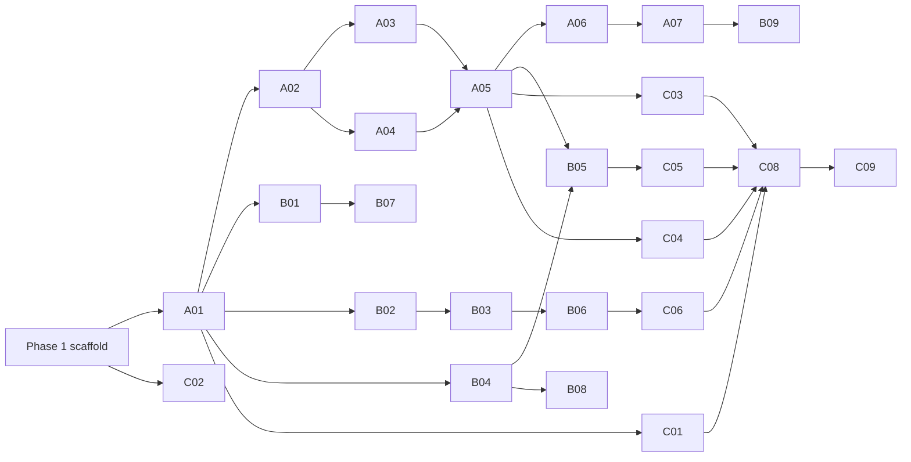

# Android work packages

All relative paths are under `apps/android/` unless prefixed `docs/android/`. `A/B/C` map to Hermes `agent1/agent2/agent3`; Codex alone merges and owns shared Gradle/manifest release integration. Every package gets one GitHub issue with `android` plus P label. Workers read full context, restate scope and plan, then report exact evidence. Each block names exclusive production/test file ownership. Owners may add a matching named test file beneath their listed test directory, without touching another package's files. Paths here are a reservation for Phase 2, not evidence the file exists now.

### A01 [P0] Contract and Android build gate
Owner: agent1 slot 1. Files: `app/src/main/java/ai/trustshield/android/core/model/Analysis.kt`, `core/model/Evidence.kt`, `app/src/test/java/ai/trustshield/android/core/model/ContractTest.kt`; Codex owns all `*.gradle.kts` and `AndroidManifest.xml`. Inputs: current API `AnalysisResult`, H2. Done: stable versioned local contract with separate risk/confidence and quote span; compile. Tests/edges: invalid severity, absent quote, low confidence. Dependency: Phase 1 scaffold.

### A02 [P0] Hinglish normalizer
Owner: agent1 slot 2. Files: `core/normalize/HinglishNormalizer.kt`, `app/src/test/java/ai/trustshield/android/core/normalize/NormalizerTest.kt`. Inputs: R5. Done: digits, zero-width, mixed script and OTP variants retain source spans. Tests/edges: emoji, 20k chars, `0TP`, `O.T.P`, `btao`, unsupported scripts. Dependency: A01.

### A03 [P0] Five-stage detector
Owner: agent1 slot 3. Files: `core/rules/StageRules.kt`, `app/src/test/java/ai/trustshield/android/core/rules/StageRulesTest.kt`. Inputs: R3/R6, A02. Done: deterministic stage evidence with exact input quotes and no single-word critical alert. Tests/edges: secrecy+money, authority alone, prompt injection as data. Dependency: A01,A02.

### A04 [P0] Legitimate indicators and negation
Owner: agent1 slot 4. Files: `core/rules/LegitimateIndicators.kt`, `app/src/test/java/ai/trustshield/android/core/rules/LegitimateIndicatorsTest.kt`. Inputs: R3.4 pairs. Done: warning vs asking disambiguation and bounded risk reduction. Tests/edges: OTP do-not-share, credit, KYC, bill, delivery; quoted scam embedded in a warning. Dependency: A02.

### A05 [P0] Local fusion and conversation state
Owner: agent1 slot 5. Files: `core/score/LocalScorer.kt`, `core/score/CallSessionState.kt`, `app/src/test/java/ai/trustshield/android/core/score/ScorerTest.kt`. Inputs: A03,A04,H2. Done: deterministic score/confidence, ask+two stage gate, stage persistence with bounded transcript lifecycle. Tests/edges: low ASR confidence, unsupported language, long call, stale stage reset. Dependency: A01–A04.

### A06 [P0] Optional backend adapter
Owner: agent1 slot 6. Files: `data/api/AnalysisApi.kt`, `data/api/ResultAdapter.kt`, `app/src/test/java/ai/trustshield/android/data/api/ResultAdapterTest.kt`. Inputs: `/api/v1/analyze/*`, current schema. Done: bounded timeouts, offline failure state, no invented quote/strength, no auto-open of URL. Tests/edges: 429/503, schema drift, OCR raw text, backend/local disagreement. Dependency: A01,A05; integration opt-in only.

### A07 [P0] Privacy and retention audit
Owner: agent1 slot 7. Files: `core/privacy/Redactor.kt`, `docs/android/PRIVACY_AUDIT.md`, `app/src/test/java/ai/trustshield/android/core/privacy/RedactionTest.kt`; Codex owns any backend proposal. Inputs: `services/history/store.py`, `services/api/main.py`. Done: mask local diagnostics, trace every stored/logged field and define remediation gate before authenticated history. Tests/edges: OTP/PIN/card/phone/UPI and OCR text in JSON. Dependency: A06.

### A08 [P0] API and offline contract fixtures
Owner: agent1 slot 8. Files: `app/src/test/java/ai/trustshield/android/data/api/OfflineContractTest.kt`, `docs/android/evidence/api-contract.md`. Inputs: A05,A06. Done: reproducible fixture comparison and explicitly documented local/backend divergence. Tests/edges: no network, timeout, unsupported input. Dependency: A05,A06.

### A09 [P1] Payment screenshot advisory
Owner: agent1 slot 9. Files: `core/payment/PaymentHints.kt`, `app/src/test/java/ai/trustshield/android/core/payment/PaymentHintsTest.kt`. Inputs: R8; extracted text only. Done: soft amount/payee/time/status hints and mandatory bank-history confirmation copy. Tests/edges: crop, clock skew, variable UTR, false success. Dependency: A02,A05; cut if P0 slips.

### B01 [P0] Android share intake
Owner: agent2 slot 1. Files: `input/share/ShareReceiver.kt`, `app/src/test/java/ai/trustshield/android/input/share/ShareReceiverTest.kt`; manifest intent filters by Codex. Inputs: Android `ACTION_SEND` docs, F01. Done: text/link/multiple image intent parse, explicit user review and bounded `content://` reads. Tests/edges: missing URI, mixed text+URL, malicious intent MIME. Dependency: A01.

### B02 [P0] QR/UPI parser
Owner: agent2 slot 2. Files: `input/qr/UpiQrParser.kt`, `app/src/test/java/ai/trustshield/android/input/qr/UpiQrParserTest.kt`. Inputs: R3.3/R7 and existing QR parser. Done: structural `upi://pay` parse, bounded/normalized `pa`/`pn`, no navigation. Tests/edges: multiple IDs, percent encoding, malformed payload, non-UPI URL. Dependency: A01.

### B03 [P0] Camera QR scanner
Owner: agent2 slot 3. Files: `input/qr/QrCameraAnalyzer.kt`, `app/src/test/java/ai/trustshield/android/input/qr/QrCameraAnalyzerTest.kt`; dependencies/permissions by Codex. Inputs: bundled ML Kit and CameraX docs. Done: latest-frame analysis, close frames, explicit camera permission handling. Tests/edges: glare, dark frame, rapid scans, no decode. Dependency: B02.

### B04 [P0] Speech capability and consent probe
Owner: agent2 slot 4. Files: `input/speech/SpeechCapability.kt`, `input/speech/SpeechConsent.kt`, `app/src/test/java/ai/trustshield/android/input/speech/CapabilityTest.kt`; manifest by Codex. Inputs: Android SpeechRecognizer API. Done: runtime `hi-IN` availability probe, on-device/offline status label and consent. Tests/edges: API 26–30, missing service/model, mic denial. Dependency: A01.

### B05 [P0] Active Call Shield speech session
Owner: agent2 slot 5. Files: `input/speech/CallSpeechSession.kt`, `app/src/test/java/ai/trustshield/android/input/speech/CallSpeechSessionTest.kt`. Inputs: B04,A05. Done: visible user-started session, bounded 2-minute transcript, no saved audio, stop destroys recognizer. Tests/edges: recognizer busy/error, noise, rotation, 2-hour stage persistence, teardown. Dependency: B04,A05.

### B06 [P0] QR watcher state machine
Owner: agent2 slot 6. Files: `input/qr/QrWatcher.kt`, `app/src/test/java/ai/trustshield/android/input/qr/QrWatcherTest.kt`. Inputs: B02,B03,R7. Done: registered payee comparison, 3 consecutive valid mismatches, missing-for-5-minutes state, PIN-protected re-register. Tests/edges: unreadable frame does not count as tamper, multiple payees, offline. Dependency: B02,B03.

### B07 [P0] Shared image bounds and OCR handoff
Owner: agent2 slot 7. Files: `input/share/SharedImageReader.kt`, `app/src/test/java/ai/trustshield/android/input/share/SharedImageReaderTest.kt`. Inputs: B01, F01. Done: size/type/dimension limits, ephemeral decode, no raw disk copy. Tests/edges: corrupt, oversized, multiple images, QR within screenshot. Dependency: B01.

### B08 [P0] ASR fallback experiment
Owner: agent2 slot 8. Files: `docs/android/evidence/speech-device-matrix.md`, `input/speech/VoskCandidate.kt` only if measured; test same named class. Inputs: target phone, Vosk 42 MB Hindi model. Done: measured offline latency/RAM/error decision; if no phone, document no-go and stage-speech fallback. Tests/edges: airplane mode, mixed English/Hindi, 10 scripted calls. Dependency: B04; no unconditional model bundle.

### B09 [P2] Notification listener feasibility spike
Owner: agent2 slot 9. Files: `docs/android/evidence/notification-listener.md` only. Inputs: Android API/policy. Done: explicit permission, content-availability and opt-out matrix; no shipped listener unless P0 and privacy gates pass. Tests/edges: sensitive/hidden notifications, app filters, revoke. Dependency: A07; cut by default.

### C01 [P0] Compose navigation shell
Owner: agent3 slot 1. Files: `app/src/main/java/ai/trustshield/android/MainActivity.kt`, `ui/navigation/AppNav.kt`, `app/src/test/java/ai/trustshield/android/ui/navigation/NavTest.kt`. Inputs: UI_SPEC, A01 fixture. Done: Home, Result, Call, QR, Settings destinations; process recreation path. Tests/edges: back stack, intent re-entry. Dependency: scaffold,A01.

### C02 [P0] Design tokens and theme
Owner: agent3 slot 2. Files: `ui/theme/Color.kt`, `ui/theme/Type.kt`, `ui/theme/Theme.kt`, `app/src/test/java/ai/trustshield/android/ui/theme/ThemeTest.kt`. Inputs: H0, UI_SPEC. Done: accent/risk colors, system/light/dark, large text contrast. Tests/edges: dynamic contrast, dark mode, reduced motion. Dependency: scaffold.

### C03 [P0] Result/evidence screen
Owner: agent3 slot 3. Files: `ui/result/ResultScreen.kt`, `app/src/test/java/ai/trustshield/android/ui/result/ResultScreenTest.kt`. Inputs: A01,A05. Done: separate risk/confidence, quotes, actions, limitations and Unable to Verify. Tests/edges: empty evidence, long quote, backend disagreement. Dependency: A01,A05,C02.

### C04 [P0] Settings and preferences UI
Owner: agent3 slot 4. Files: `ui/settings/SettingsScreen.kt`, `data/preferences/UserPreferences.kt`, `app/src/test/java/ai/trustshield/android/ui/settings/SettingsTest.kt`. Inputs: F08. Done: theme, language, sensitivity, haptics with reset/default and no raw text persistence. Tests/edges: process restart, accessibility toggle. Dependency: C02,A05.

### C05 [P0] Call Shield screen
Owner: agent3 slot 5. Files: `ui/call/CallShieldScreen.kt`, `app/src/test/java/ai/trustshield/android/ui/call/CallScreenTest.kt`. Inputs: B04,B05,A05. Done: consent, active state, stage chips, clear stop, low-confidence/error and haptic warning. Tests/edges: permission denial, background, recognizer unavailable, accidental repeat alert. Dependency: B05,C02.

### C06 [P0] QR Guard screen
Owner: agent3 slot 6. Files: `ui/qr/QrGuardScreen.kt`, `app/src/test/java/ai/trustshield/android/ui/qr/QrGuardScreenTest.kt`. Inputs: B03,B06. Done: register/watch/re-register flow, visible-camera status, unreadable vs mismatch. Tests/edges: dual merchant QR, rotation, no camera. Dependency: B06,C02.

### C07 [P0] Accessibility/interaction audit
Owner: agent3 slot 7. Files: `docs/android/evidence/accessibility.md`, `app/src/androidTest/java/ai/trustshield/android/AccessibilitySmokeTest.kt`. Inputs: C01–C06. Done: TalkBack order/labels, 200% text, 48dp touch targets, contrast and reduced motion evidenced. Tests/edges: alerts not color-only, English/Hinglish strings. Dependency: C01–C06.

### C08 [P0] Instrumented user journeys
Owner: agent3 slot 8. Files: `app/src/androidTest/java/ai/trustshield/android/DemoJourneysTest.kt`, `docs/android/evidence/device-run.md`. Inputs: integrated app. Done: share→result, staged call→warning, QR mismatch, settings/offline on emulator and phone if present; exact gaps recorded. Tests/edges: no permission, airplane mode, activity recreation. Dependency: A05,B01,B05,B06,C01–C06.

### C09 [P1] Demo and release handoff
Owner: agent3 slot 9. Files: `docs/android/DEMO_SCRIPT.md`, `docs/android/evidence/rehearsal.md`. Inputs: C08, quality gates. Done: 10 timed rehearsals, backup staged speech, APK hash/size/install log; no new accuracy claim. Tests/edges: WiFi failure, phone lock, noisy room. Dependency: C08; starts only after P0 green.

## Dependency graph

Codex integrates manifest/build dependencies only after package tests and owns any cross-file resolution. `A09`, `B09`, `C09` never block P0.

## GitHub issue map (opened in Phase 1)

`A01`–`A09`: #24–#32; `B01`–`B09`: #33–#41; `C01`–`C08`: #42–#49; `C09`: #51. Phase 1 plan/build tracking: #50. All package issues remain open for Phase 2.
